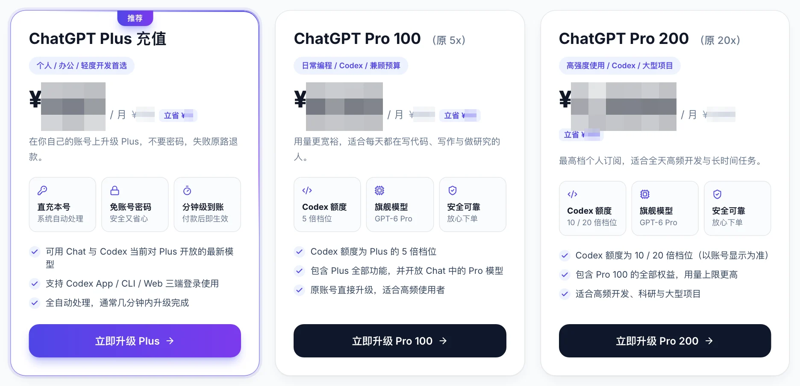

# ChatGPT 代充靠谱吗？2026 国内充值 ChatGPT Plus / Pro 避坑指南：价格、安全、流程、售后

> 最后更新：2026 年 10 月 20 日（北京时间）· 本次核对了 OpenAI 官方套餐价格、国内代充平台的人民币报价，以及支付宝 / 微信自助开通流程的 7 张最新截图。价格或流程有变化会在这里更新，点右上角 **Watch** 可以收到通知；发现过期内容欢迎提 Issue。

在百度、谷歌搜「ChatGPT 代充」，出来的结果从 ¥60 的「独享号」到 ¥200 的「官方通道」都有，看得人不知道该信谁。这篇文章只回答一件事：**代充到底靠不靠谱，怎么判断，怎么付，出了问题怎么办。** 没有海外信用卡、不想折腾美区 Apple ID 的国内用户，看完这一篇就够了。

先给结论：**代充本身没问题，有问题的是「要你密码的人工代充」和「多人共用一个号的合租」。** 选对交付方式（不要密码、开在你自己的账号上、不成功原路退款），代充就是目前国内开 ChatGPT Plus / Pro 最省事的方式，安卓和 iPhone 都能用。

> [!TIP]
> **想直接开通？** 用 **支付宝 / 微信** 付款，粘贴一段账号信息（不含密码），**3 分钟** Plus / Pro 开在你自己的账号上。不换号、不装软件，不成功原路退款。
>
> **👉 [okai66.com — ChatGPT Plus / Pro 自助充值，Claude Pro 同样支持](https://okai66.com/)**
>
> 怎么操作见下文 [4 步实测截图](#实测支付宝--微信-4-步自助开通-chatgpt-plus--pro)；想先弄清楚安不安全，往下看。

---

## 目录

- [先分清：市面上的「代充」其实是三种东西](#先分清市面上的代充其实是三种东西)
- [2026 年 ChatGPT 套餐人民币价格速查](#2026-年-chatgpt-套餐人民币价格速查)
- [代充的钱是怎么付出去的](#代充的钱是怎么付出去的)
- [判断一个代充靠不靠谱：7 个信号](#判断一个代充靠不靠谱7-个信号)
- [实测：支付宝 / 微信 4 步自助开通 ChatGPT Plus / Pro](#实测支付宝--微信-4-步自助开通-chatgpt-plus--pro)
- [会话信息是什么，别人拿到能干嘛](#会话信息是什么别人拿到能干嘛)
- [出了问题怎么办：没到账、掉订阅、退款](#出了问题怎么办没到账掉订阅退款)
- [什么情况下不该用代充](#什么情况下不该用代充)
- [常见问题 FAQ](#常见问题-faq)
- [一句话总结](#一句话总结)
- [相关页面](#相关页面)
- [English summary](#english-summary)

---

## 先分清：市面上的「代充」其实是三种东西

同样叫「ChatGPT 代充」，交付方式完全不同，风险也完全不同：

| 类型 | 怎么交付 | 典型价格 | 风险 | 结论 |
|---|---|---|---|---|
| **① 本号自助直充** | 你在网站自助下单，提交一段**不含密码**的账号信息，平台自动把订阅开到你自己的账号上 | Plus ¥160–180 / 月 | 低。账号始终在你手里，失败原路退款 | **推荐** |
| **② 要密码的人工代充** | 把账号密码发给客服，对方登录你的账号手动绑卡付款 | Plus ¥130–170 / 月 | 高。对方可以改密码、看对话；常用黑卡，几天后掉订阅 | 不要用 |
| **③ 合租 / 共享号 / 成品号** | 卖家给你一个已经开了 Plus 的账号，多人共用或「独享」 | ¥30–90 / 月 | 极高。对话别人可见、随时被改密码、账号批量注册易封、无售后 | 别碰，详见 [合租共享号分析](https://imi0801.github.io/chatgpt-plus-recharge-guide/shared-account/) |

下文说的「代充」，如无特别说明都指第 ① 种。

---

## 2026 年 ChatGPT 套餐人民币价格速查

| 套餐 | 官方价格（美元） | 国内代充参考价（人民币 / 月） | 适合谁 |
|---|---|---|---|
| Free | $0 | — | 偶尔用用 |
| Go | $8 / 月 | 多数平台不做 | 预算敏感，部分地区带广告 |
| **Plus** | $20 / 月 | **约 ¥165** | 日常写作、学习、资料分析、轻度 Codex |
| **Pro 100**（原 5×） | $100 / 月 | 约 ¥830 | 每天用 Codex，Plus 额度经常用完 |
| **Pro 200**（原 20×） | $200 / 月 | 约 ¥1,500 | 高强度开发、长任务、多项目并行 |
| Pro 500 | $500 / 月 | 约 ¥4,100 | 全天跑多个智能体 |

- 官方价不含税；按当前汇率 $20 ≈ ¥135–140，代充价高出的 ¥25–30 是渠道成本、支付手续费和售后，这是正常区间。
- **Plus 报价低于 ¥140 的，基本可以判定为黑卡或盗刷卡**，开通后几天内会被 OpenAI 回滚。
- 代充平台的报价会随汇率浮动，下单前以平台套餐页为准。各渠道逐项对比见 [ChatGPT Plus / Pro 人民币价格表](https://imi0801.github.io/chatgpt-plus-recharge-guide/price/)。

---

## 代充的钱是怎么付出去的

弄懂这一点，就能自己判断一个平台靠不靠谱。

OpenAI 官网只收海外信用卡（经 Stripe），国内卡几乎全部被拒。代充平台要做的事，就是**用一种 OpenAI 愿意收的支付方式，替你把这笔订阅付掉**。来源大致分两类：

- **正规渠道：** 平台自己持有海外企业支付能力、合规采购的礼品卡或与支付机构合作的通道。成本高于官方价，所以合理的代充价一定**高于** $20 折算的人民币。
- **问题渠道：** 盗刷的信用卡、来路不明的低价礼品卡。成本接近于零，所以能卖 ¥60–120。OpenAI 的风控会在几天到几周内识别并回滚付款，表现就是你的 Plus 突然消失（掉订阅）。严重时该账号后续再绑任何卡都会被拒。

所以「代充安全吗」这个问题，本质上是「这家平台的支付来源干不干净」。价格是第一个信号，交付方式是第二个信号。

---

## 判断一个代充靠不靠谱：7 个信号

| | 绿灯（可以用） | 红灯（直接排除） |
|---|---|---|
| 1. 账号凭证 | 只要会话信息或账号 ID，**不要密码** | 要账号密码、要你「共享登录」 |
| 2. 价格 | Plus ¥160–190，Pro 100 ¥800–900 | Plus 低于 ¥140，或 Pro 价格明显低于官方价折算 |
| 3. 下单方式 | 有独立网站，自助下单、自助查订单 | 只在淘宝 / 闲鱼 / 微信群里转账 |
| 4. 付款前校验 | 付款前就能显示你的账号邮箱、当前套餐，并拦下「已是 Plus」「在 Team 工作区」「欠费中」等情况 | 先收钱，再问你要账号 |
| 5. 退款规则 | 写明**不成功原路退款**，当天退回 | 「退到平台余额」「只能换别的服务」或根本没写 |
| 6. 到账方式 | 系统自动充值，订单页能看到「已付款 → 充值中 → 完成」 | 人工手充，「等客服上班」 |
| 7. 售后 | 有客服时段和响应承诺，订单可追溯 | 出问题就拉黑 |

7 条里有任何一条红灯，就换一家。这些指标对任何平台都适用，不限于本文提到的。

**👉 [按这 7 条对照过的平台：okai66.com，支付宝 / 微信自助开通，不要密码，原路退款](https://okai66.com/)**

---

## 实测：支付宝 / 微信 4 步自助开通 ChatGPT Plus / Pro

下面是 2026 年 10 月在 [OKAI66](https://okai66.com/) 上的真实流程。从付款到 Plus 生效一般在 3 分钟以内，Plus、Pro 100、Pro 200 操作完全一样。截图中的价格已打码，以站内实时价格为准。

### 第 1 步：选套餐

打开套餐页，选 Plus 或 Pro，点「立即充值」。

### 第 2 步：粘贴一段账号信息，系统自动校验

1. 在电脑或手机浏览器里登录你要充值的 ChatGPT 账号（建议 Chrome，关掉会改动网页的插件）。
2. 在**同一个浏览器**里打开 `chatgpt.com/api/auth/session`，页面会显示一段 JSON 文本，全选复制。这就是「会话信息」，**不含密码**，具体安全边界见 [下一节](#会话信息是什么别人拿到能干嘛)。

3. 回到下单页粘贴。系统会自动校验并显示这个账号的邮箱、用户名和当前套餐，你可以确认是不是要充的账号。如果账号已经是 Plus，会提示「将覆盖现有会员」；如果账号在 Team 工作区或处于欠费宽限期，会直接拦下，不让你白付钱。

### 第 3 步：确认订单，支付宝 / 微信付款

填一个你记得住的手机号或邮箱（只用来查订单和售后），点「确认订单，去支付」。

选支付宝或微信。电脑端扫码，手机端直接跳转。页面会显示商品金额和预估手续费，实付以支付页为准。

> 在线付款有 2% 的第三方支付手续费（支付通道收的）。不想出这笔钱，可以加客服微信直接开通，免手续费。

### 第 4 步：等待自动到账，回 ChatGPT 核对

付款后系统自动充值，订单页依次显示「已付款 → 充值中 → 完成」，完成后可以下载订单凭证。

回到 ChatGPT 刷新页面（没变化就退出重登），在「设置 → 账单」里确认已显示 Plus 和到期日。

页面上写「套餐已取消，将不再续订」是**正常的**：代充开通的会员不自动扣款，到期前回来再充一次即可。续费规则详见 [续费 / 到期 / 取消自动扣费](https://imi0801.github.io/chatgpt-plus-recharge-guide/renew/)。

**👉 [照着这 4 步，现在去开通 → okai66.com](https://okai66.com/)**

---

## 会话信息是什么，别人拿到能干嘛

这是大家最关心的安全问题，讲清楚：

- **它是什么：** 你当前这一次登录 ChatGPT 的临时凭证，相当于「这个浏览器已经登录了」的证明。
- **它不包含什么：** 不包含密码。拿到它的人**改不了密码、改不了邮箱、解绑不了手机、登不出你**。
- **它能做什么：** 在有效期内，以你的身份访问 ChatGPT 页面。代充平台用它来确认「订阅要开到哪个账号」。
- **它什么时候失效：** 有有效期；你在 ChatGPT「设置 → 安全 → 登出所有设备」点一下，它立刻作废。正规平台在充值完成后会自动删除。

对比一下：**账号密码**是永久凭证，拿到就能改掉你的一切；**会话信息**是临时凭证，随时可以让它失效。这就是为什么「只要会话信息」的平台可以用，「要密码」的平台不能用。

如果你用的是 Claude，交付方式更简单，只需要账号的 Organization ID，连会话信息都不用。

---

## 出了问题怎么办：没到账、掉订阅、退款

### 付了款，订单一直「充值中」

先等 5–10 分钟，高峰期有排队。超过 30 分钟仍未完成，带订单号联系客服。正规平台会给出明确的客服时段（例如每天 9:00–23:00）和响应时间。

### 订单「完成」了，ChatGPT 还是 Free

退出重新登录，或清一下浏览器缓存。仍然没有的话，截一张「设置 → 账户」的图发客服。绝大多数情况是页面没刷新，不是没充上。

### 充完几天后 Plus 突然没了（掉订阅）

这是**付款被 OpenAI 回滚**，几乎只发生在黑卡渠道。正规平台会按退款规则处理或补充。分清两件事：

- **掉订阅**：账号变回 Free，对话都在，可以重新开。
- **封号**：账号无法登录，原因是账号行为（高风险 IP、内容违规、批量注册），**和付款方式无关**。

### 怎么退款

正规平台「不成功原路退款」：支付宝退支付宝，微信退微信，当天到账。退到「平台余额」的不算。

---

## 什么情况下不该用代充

代充是「没有海外卡」用户的最优解，但不是所有人的最优解：

- **你有一张海外发行的 Visa / Master 卡**，账单地址在海外：直接官网订阅，最便宜最正规，还能自动续费。
- **你有 iPhone，愿意花一两个小时弄美区 Apple ID**，只开 Plus 不开 Pro：支付宝买美区 Apple 礼品卡在 App 内订阅，每月约 ¥135–140，比代充便宜 ¥25 左右。
- **你要开 Pro 或 Claude**：礼品卡面额固定、凑多张麻烦，Claude 的 App 内购对地区限制更严，这两种情况代充反而是最省事的。

四条路线的完整成本和风险对比，可以看 [ChatGPT Plus 国内开通指南](https://dsom-w.github.io/chatgpt-plus-guide/)。

---

## 常见问题 FAQ

### Q：ChatGPT 代充安全吗？会不会被封号？

选「不要密码、开在你自己账号上、原路退款」的平台就安全。封号的原因是账号行为（高风险 IP、内容违规），和付款方式没有直接关系；代充真正要避开的风险是黑卡导致的「掉订阅」，看价格和交付方式就能避开。

### Q：代充需要提供 ChatGPT 账号密码吗？

正规平台不需要。只要一段会话信息（ChatGPT）或账号 ID（Claude）。任何要密码的，直接排除。

### Q：ChatGPT Plus 代充多少钱？

2026 年 10 月市场价约 ¥160–180 / 月，Pro 100 约 ¥830，Pro 200 约 ¥1,500。低于 ¥140 的 Plus 基本是黑卡。

### Q：支付宝 / 微信能直接付给 OpenAI 吗？

不能。OpenAI 官网只收信用卡和部分地区的 PayPal。所有「支付宝开 Plus」本质上都是礼品卡或代充。

### Q：代充的 Plus 和官网开的有区别吗？

权益完全一样，都是开在你账号上的正式订阅，GPT-6、Codex、图片生成、文件分析等功能一样。唯一区别是代充不自动续费，到期前需要再充一次。

### Q：充值多久到账？

付款后系统自动处理，通常 1–5 分钟。超过 30 分钟联系客服。

### Q：安卓手机能用代充吗？

能。订阅绑定的是你的 OpenAI 账号，不是设备。网页端开通后，安卓、iPhone、电脑登录同一账号都是 Plus。详见 [安卓用户开通指南](https://imi0801.github.io/chatgpt-plus-recharge-guide/android/)。

### Q：已经是 Plus，再充会叠加时长吗？

不会，新订阅覆盖旧的。等快到期再充。Plus 升 Pro 同理，Plus 剩余天数不退不接。

### Q：可以开发票吗？企业批量开通？

正规平台支持补开发票（可能有差价）和批量充值、对公转账，联系客服说明数量。

### Q：代充失败了钱怎么办？

正规平台原路退款，当天退回原支付方式。订单页能看到退款状态。

---

## 一句话总结

代充靠不靠谱，看三件事：**不要密码、开在你自己账号上、不成功原路退款。** 三条都满足，就是国内没有海外卡时开 ChatGPT Plus / Pro 最省事的方式，支付宝 / 微信 3 分钟搞定。

**👉 [okai66.com — 支付宝 / 微信开通 ChatGPT Plus / Pro、Claude Pro，不要密码](https://okai66.com/)**

---

## 相关页面

- [ChatGPT Plus / Pro 多少钱？2026 人民币价格表](https://imi0801.github.io/chatgpt-plus-recharge-guide/price/)
- [安卓 / 没有 iPhone 怎么开 ChatGPT Plus](https://imi0801.github.io/chatgpt-plus-recharge-guide/android/)
- [Codex 充值：Plus 和 Pro 的额度差多少，用完怎么办](https://imi0801.github.io/chatgpt-plus-recharge-guide/codex/)
- [ChatGPT Plus 合租 / 共享号 / 成品号靠谱吗](https://imi0801.github.io/chatgpt-plus-recharge-guide/shared-account/)
- [ChatGPT Plus 续费、到期、取消自动扣费](https://imi0801.github.io/chatgpt-plus-recharge-guide/renew/)
- 本文网页版（手机阅读更方便）：[imi0801.github.io/chatgpt-plus-recharge-guide](https://imi0801.github.io/chatgpt-plus-recharge-guide/)
- [ChatGPT Plus 怎么开通？注册、电脑、iPhone、Pro 开通教程](https://imi0801.github.io/chatgpt-plus-goplus/)
- [ChatGPT 充值教程：支付宝 / 微信充值步骤、价格、到账](https://imi0801.github.io/chatgpt-guide/)
- [ChatGPT 订阅百科：付款失败、取消订阅、退款、套餐对比](https://imi0801.github.io/chatgpt-plus-guide/)

---

## English summary

**How to pay for ChatGPT Plus / Pro from mainland China (2026).** OpenAI's checkout only accepts foreign-issued cards, so most Chinese users rely on a third-party top-up service that charges in RMB via Alipay or WeChat Pay. A trustworthy service never asks for your password: it only needs a session token (for ChatGPT) or an Organization ID (for Claude), applies the subscription to your own account within minutes, and refunds to the original payment method on failure. Expect Plus to cost about ¥160–180 per month; anything under ¥140 is almost certainly paid with stolen cards and will be rolled back by OpenAI. Shared or "ready-made" accounts are not worth the risk. The guide above walks through pricing, how to vet a service, and the 4-step Alipay / WeChat Pay flow at [okai66.com](https://okai66.com/).

---

## 关于本文

- 本文作者与 [OKAI66](https://okai66.com/guide) 存在商业关系，该平台提供 ChatGPT / Claude 等订阅的付费充值服务；文中实测部分涉及该产品，7 个判断信号对任何平台都适用，请结合自身情况判断。
- OKAI66 为独立第三方服务平台，与 OpenAI、Anthropic、Apple 均无隶属关系。ChatGPT、Codex、Claude 等名称归其各自权利方所有，订阅权益以你账号内实际显示为准。
- 内容按 [CC BY-NC-SA 4.0](LICENSE) 许可，转载请注明出处。发现价格或流程变化，欢迎提 Issue 或 PR。
